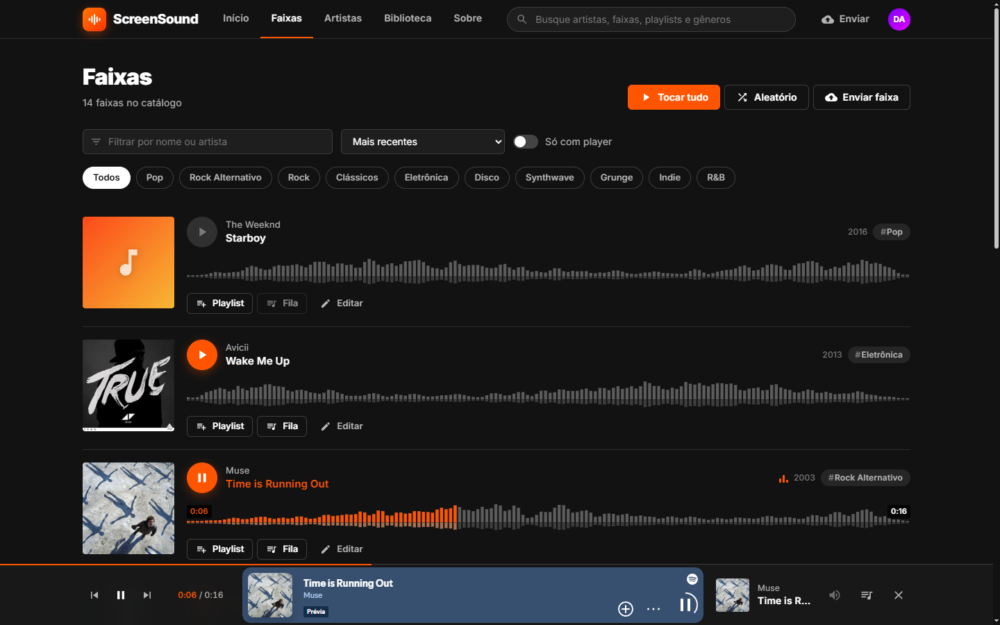
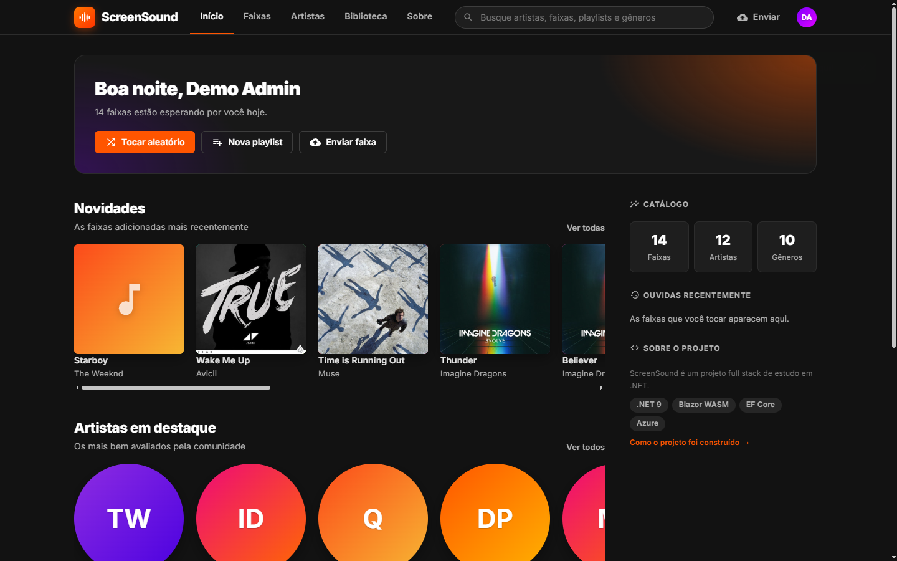
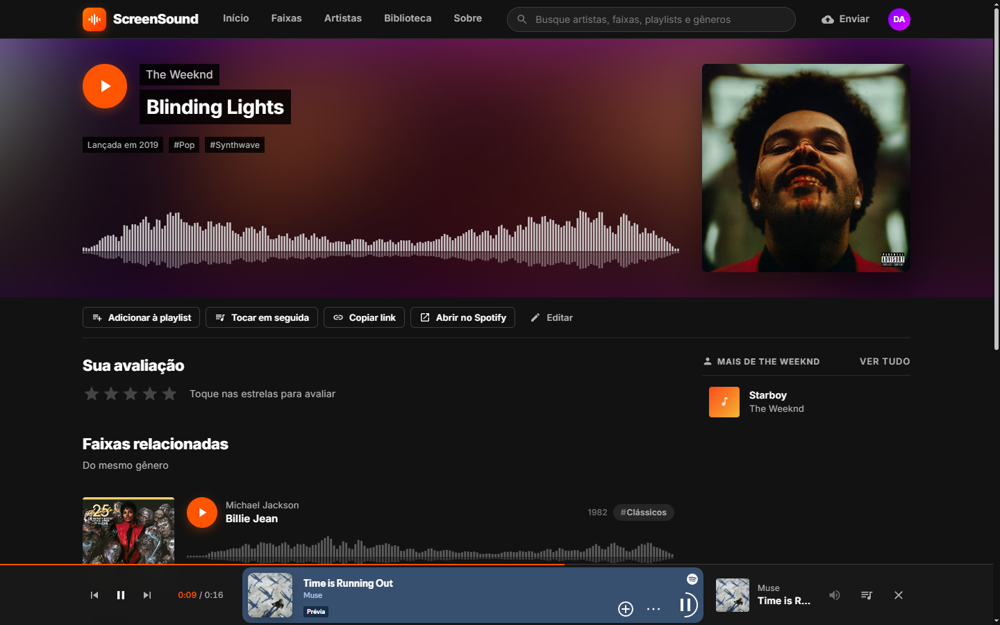
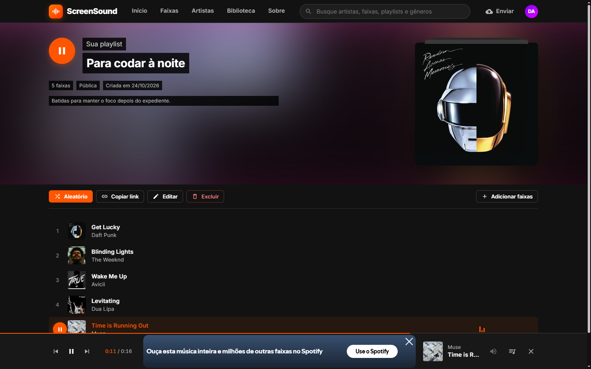
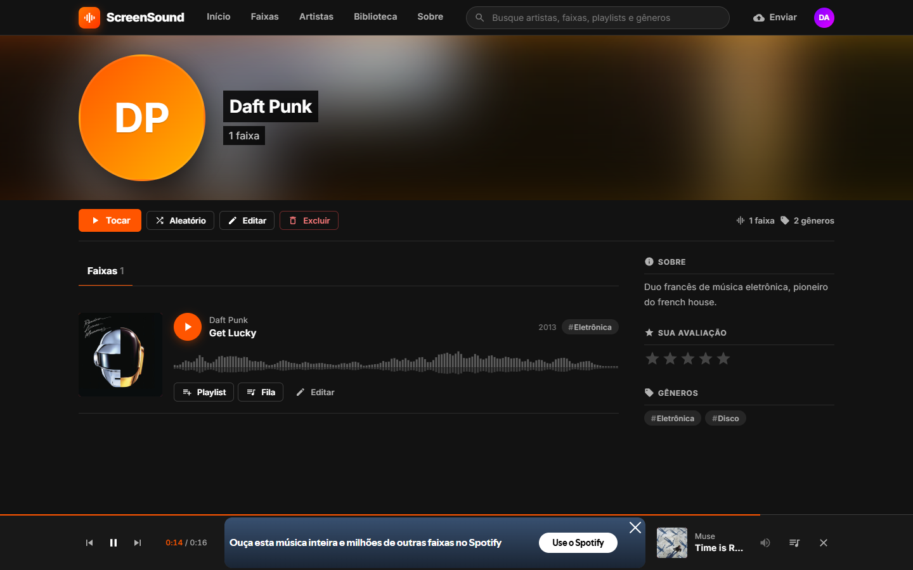
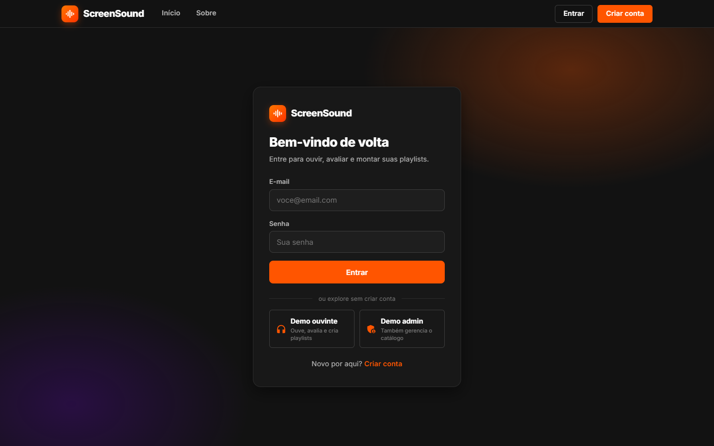
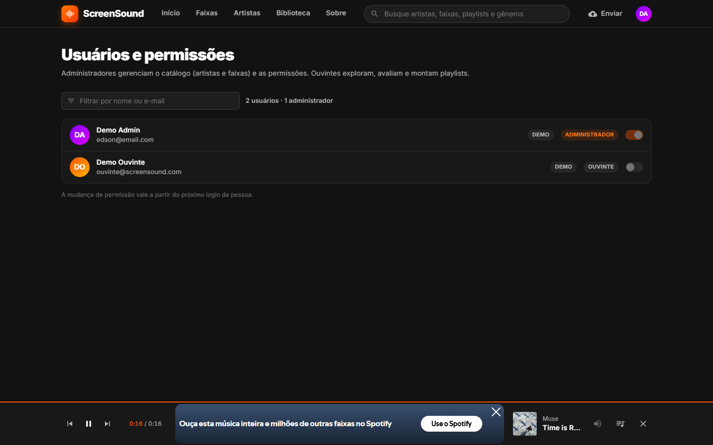
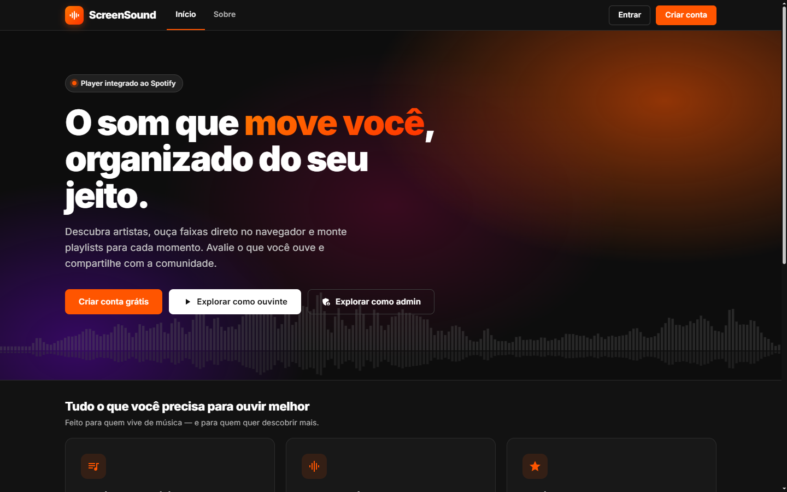
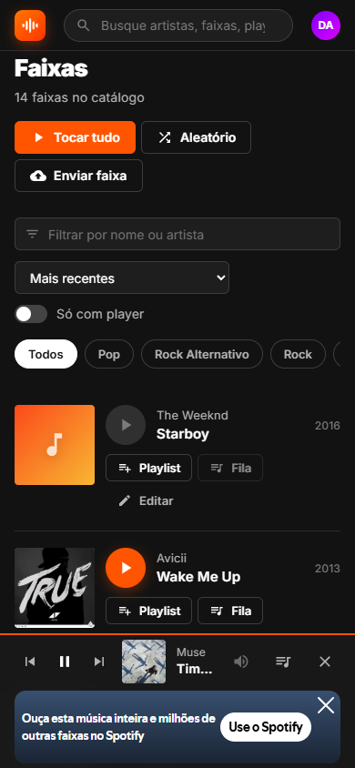
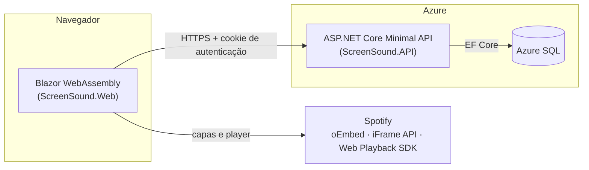

<div align="center">


# ScreenSound

**Plataforma de descoberta musical inspirada no SoundCloud, construída de ponta a ponta em .NET 9.**

Explore artistas e faixas, ouça direto no navegador com um player integrado ao Spotify, avalie o que ouve e organize tudo em playlists.

[](https://github.com/EdsonMiziara/ScreenSound/actions/workflows/ci.yml)


### [▶ Acessar a demonstração](https://screensound-web-edson-fwcma8bdb4a8h0c7.brazilsouth-01.azurewebsites.net)

Entre com um clique em **Demo ouvinte** ou **Demo admin** na tela de login, sem precisar se cadastrar.



</div>

---

## Sumário

- [Sobre o projeto](#sobre-o-projeto)
- [Funcionalidades](#funcionalidades)
- [Telas](#telas)
- [Destaques técnicos](#destaques-técnicos)
- [Arquitetura](#arquitetura)
- [Tecnologias](#tecnologias)
- [Como rodar](#como-rodar)
- [Configuração](#configuração)
- [API](#api)
- [Testes e CI/CD](#testes-e-cicd)
- [Próximos passos](#próximos-passos)
- [English summary](#english-summary)

---

## Sobre o projeto

O ScreenSound começou como um app de console para estudar C# e evoluiu para uma aplicação web completa, publicada no Azure. Hoje ele reúne, em um único repositório, as peças de um produto real:

- uma **API REST** em ASP.NET Core com autenticação, perfis de acesso e regras de negócio;
- um **front-end SPA** em Blazor WebAssembly, com interface inspirada no SoundCloud;
- **persistência** em SQL Server / Azure SQL com Entity Framework Core e migrations;
- **integração com o Spotify** (capas, player público e player Premium via OAuth);
- **testes automatizados**, **Docker** e **deploy contínuo** com GitHub Actions.

O objetivo é demonstrar, na prática, como projetar, construir, testar e publicar uma aplicação .NET full stack.

## Funcionalidades

| Ouvinte | Administrador |
| --- | --- |
| Explora faixas e artistas com busca global, filtro por gênero e ordenação | Tudo o que o ouvinte faz |
| Player contínuo com fila, que acompanha a navegação entre páginas | Cadastra, edita e exclui artistas (com foto) e faixas |
| Waveform clicável no estilo SoundCloud para avançar a música | Vincula faixas ao Spotify com validação do link e prévia da capa |
| Playlists públicas ou privadas, com reordenação de faixas | Cria gêneros dinamicamente durante o cadastro |
| Avaliação de faixas e artistas (1 a 5 estrelas) | Promove e rebaixa usuários na tela de permissões |
| Perfil editável: nome de exibição, bio, foto e senha | |
| Conexão com Spotify Premium para ouvir faixas completas, com volume | |

As permissões são verificadas **na API** (políticas de autorização), e a interface se adapta ao perfil de quem está logado.

## Telas

| Início | Página da faixa |
| --- | --- |
|  |  |
| **Playlist** | **Perfil do artista** |
|  |  |
| **Login com contas demo** | **Usuários e permissões (admin)** |
|  |  |

<details>
<summary><b>Landing page e versão mobile</b></summary>
<br />


</details>

## Destaques técnicos

**Back-end**
- **Minimal APIs organizadas por recurso**, com CORS e autorização aplicados nos grupos e a política `Admin` nas rotas de escrita do catálogo.
- **ASP.NET Identity** com cookies seguros entre domínios (`SameSite=None; Secure`), perfis (`Administrador`) e claims consumidas pelo front.
- **Repositório genérico assíncrono + Unit of Work** sobre o EF Core, consultas `AsNoTracking` para leitura e `AsSplitQuery` nas consultas com vários `Include`.
- **Regras no domínio**: entidades com validação própria (nome, link do Spotify, ordem das faixas na playlist), cobertas por testes unitários.
- **Proteções pensadas para uma demo pública**: as contas demo não podem trocar a senha nem ter o perfil alterado, um admin não pode remover o próprio acesso, e uploads aceitam só JPEG de até 2 MB.
- **Inicialização configurável**: migrations, criação das contas demo e catálogo de exemplo controlados por configuração (ligados no Docker, desligados em produção).

**Front-end**
- **Blazor WebAssembly** com componentes reutilizáveis (cards, linha de faixa, waveform, player, diálogos) e um design system próprio em CSS, responsivo e com tema escuro.
- **Player global com dois motores** sobre a mesma fila: o embed público do Spotify (funciona para todos) e o **Web Playback SDK** para assinantes Premium, com login **OAuth 2.0 + PKCE** feito inteiramente no navegador, sem expor segredos.
- **JS interop** enxuto para o que o Blazor não faz nativamente (iFrame API, SDK, área de transferência).
- Capas reais obtidas pelo **oEmbed do Spotify**, com cache em memória e gradiente de fallback.
- Interface que reflete o perfil do usuário (`AuthorizeView` por perfil e página de acesso negado).

**Qualidade e DevOps**
- Testes unitários com **xUnit** e testes de integração com **Testcontainers** (SQL Server real em Docker).
- **CI no GitHub Actions** (testes unitários e de integração, build com o SDK 9 e build das imagens Docker) e **deploy contínuo** da API e do front no **Azure App Service**, que só acontece se os testes passarem.
- **Docker Compose** sobe banco, API e front com um comando; o nginx serve o Blazor e faz proxy da API na mesma origem.

## Arquitetura



```
ScreenSound/
├── ScreenSound.API/              # Minimal API: endpoints, segurança, inicialização do banco
├── ScreenSound.Web/              # Front-end Blazor WebAssembly (páginas, componentes, serviços)
├── ScreenSound.Shared.Modelos/   # Domínio: entidades, validações e utilitários (ex.: links do Spotify)
├── ScreenSound.Shared.Data/      # EF Core: DbContext, repositório genérico, Unit of Work e migrations
├── ScreenSound.Teste/            # Testes unitários (xUnit)
├── ScreenSound.Teste.Integracao/ # Testes de integração da API (Testcontainers)
├── ScreenSound/                  # App de console original, ponto de partida do projeto
├── docker-compose.yml            # Banco + API + front para rodar localmente
└── .github/workflows/            # CI e deploy no Azure
```

## Tecnologias

| Camada | Tecnologias |
| --- | --- |
| Back-end | C#, .NET 9, ASP.NET Core Minimal APIs, ASP.NET Identity, AutoMapper, Swagger |
| Dados | Entity Framework Core 9, SQL Server 2022, Azure SQL |
| Front-end | Blazor WebAssembly, MudBlazor, CSS próprio, JavaScript (interop) |
| Integrações | Spotify oEmbed, Spotify iFrame API, Spotify Web Playback SDK, OAuth 2.0 PKCE |
| Testes | xUnit, Testcontainers, WebApplicationFactory |
| DevOps | Docker, Docker Compose, nginx, GitHub Actions, Azure App Service |

## Como rodar

### Opção 1: Docker (recomendado)

Pré-requisito: [Docker Desktop](https://www.docker.com/products/docker-desktop/) com pelo menos **4 GB de memória** disponíveis (o SQL Server exige 2 GB).

```bash
git clone https://github.com/EdsonMiziara/ScreenSound.git
cd ScreenSound
docker compose up --build
```

| Serviço | Endereço |
| --- | --- |
| Aplicação | http://localhost:8080 |
| API (Swagger) | http://localhost:5095/swagger |

Na primeira execução o banco é criado com as migrations e populado com artistas, faixas, playlists e as contas demo:

| Perfil | E-mail | Senha |
| --- | --- | --- |
| Administrador | `edson@email.com` | `Senh@123` |
| Ouvinte | `ouvinte@screensound.com` | `Ouvinte@123` |

> No Windows, se o SQL Server encerrar com *"requires at least 2000 megabytes of memory"*, aumente o limite em `%USERPROFILE%\.wslconfig` (`memory=4GB`) e rode `wsl --shutdown`.

### Opção 2: localmente com o .NET SDK

Pré-requisitos: [.NET SDK 9](https://dotnet.microsoft.com/download/dotnet/9.0) e um SQL Server (LocalDB, Docker ou Azure SQL).

```bash
# 1. Connection string (fica fora do repositório, nos user-secrets)
dotnet user-secrets set "ConnectionStrings:ScreenSoundDB" "Server=(localdb)\MSSQLLocalDB;Database=ScreenSound;Trusted_Connection=True;TrustServerCertificate=True" --project ScreenSound.API
dotnet user-secrets set "Cors:AllowedOrigins" "https://localhost:7265" --project ScreenSound.API

# 2. Banco de dados
dotnet tool restore --tool-manifest ScreenSound.API/.config/dotnet-tools.json
dotnet ef database update --project ScreenSound.Shared.Data --startup-project ScreenSound.API

# 3. API (https://localhost:7278) e front (https://localhost:7265), cada um em um terminal
dotnet run --project ScreenSound.API --launch-profile https
dotnet run --project ScreenSound.Web --launch-profile https
```

As contas demo são criadas automaticamente quando a API sobe. Para ter também o catálogo de exemplo, inicie a API com `dotnet run --project ScreenSound.API --launch-profile https -- --Banco:PopularCatalogoDemo=true`.

## Configuração

| Chave | Projeto | Descrição |
| --- | --- | --- |
| `ConnectionStrings:ScreenSoundDB` | API | Connection string do SQL Server |
| `Cors:AllowedOrigins` | API | Origens do front permitidas, separadas por vírgula |
| `Cookies:EntreDominios` | API | `true` (padrão) quando front e API estão em domínios diferentes; `false` quando ficam na mesma origem (Docker) |
| `Banco:AplicarMigracoesAoIniciar` | API | Aplica as migrations pendentes ao iniciar |
| `Banco:PopularCatalogoDemo` | API | Popula o catálogo de exemplo se o banco estiver vazio |
| `Acesso:Administradores` | API | E-mails que sempre recebem o perfil de administrador |
| `Acesso:ContasDemo` | API | Contas públicas de demonstração (e-mail, senha, nome, admin) |
| `APIServer:Url` | Web | URL da API (absoluta, ou relativa ao site, como `api/` no Docker) |
| `Spotify:ClientId` | Web | Client ID de um app no [Spotify Developer](https://developer.spotify.com/dashboard). Habilita o modo Premium |
| `Spotify:RedirectUri` | Web | Opcional. Padrão: `{site}/spotify/callback`, que precisa estar cadastrado no app do Spotify |

O front tem um arquivo por ambiente: `appsettings.json` (produção), `appsettings.Development.json` (API local) e `appsettings.Docker.json` (proxy do nginx).

## API

Documentação interativa no Swagger (`/swagger` em desenvolvimento). Principais recursos:

| Recurso | Endpoints | Acesso |
| --- | --- | --- |
| Autenticação | `POST /auth/register`, `POST /auth/login`, `POST /auth/logout` | Público / logado |
| Perfil | `GET` e `PUT /Perfil`, `PUT` e `DELETE /Perfil/Foto`, `POST /Perfil/Senha` | Logado |
| Faixas | `GET /Musicas`, `GET /Musicas/{nome}`, `POST /Musicas/Avaliacao/{id}` | Logado |
| Faixas (gestão) | `POST`, `PUT /Musicas`, `DELETE /Musicas/{id}` | Admin |
| Artistas | `GET /Artistas`, `GET /Artistas/{nome}`, `POST /Artistas/Avaliacao/{id}` | Logado |
| Artistas (gestão) | `POST`, `PUT /Artistas`, `DELETE /Artistas/{id}` | Admin |
| Playlists | `GET /Playlists`, `GET /Playlists/Publicas`, `GET`, `PUT` e `DELETE /Playlists/{id}`, `POST /Playlists` | Logado (edição só pelo dono) |
| Faixas da playlist | `POST` e `DELETE /Playlists/{id}/Musicas/{musicaId}`, `PUT /Playlists/{id}/Ordem` | Dono |
| Usuários | `GET /Usuarios`, `PUT /Usuarios/{id}/Admin` | Admin |

## Testes e CI/CD

```bash
# Testes unitários
dotnet test ScreenSound.Teste

# Testes de integração (precisam do Docker em execução)
dotnet test ScreenSound.Teste.Integracao
```

| Workflow | Quando roda | O que faz |
| --- | --- | --- |
| `ci.yml` | Push e pull request na `master` | Testes unitários e de integração, build da API e do front com o SDK 9, build das imagens Docker |
| `deploy-api.yml` | Push com mudanças na API, dados ou domínio | Testes → publish → Azure App Service |
| `deploy-web.yml` | Push com mudanças no front ou no domínio | Testes → publish → Azure App Service |

## Próximos passos

- Paginação e busca no servidor (hoje a filtragem do catálogo é feita no cliente).
- Armazenar as fotos no Azure Blob Storage em vez do disco do App Service.
- Testes de componentes do front com bUnit.
- Cache das consultas mais acessadas.

## Autor

Desenvolvido por **[EdsonMiziara](https://github.com/EdsonMiziara)**.
<!-- Adicione aqui o link do seu LinkedIn, por exemplo: [LinkedIn](https://www.linkedin.com/in/seu-perfil) -->

Sugestões e feedback são bem-vindos: abra uma [issue](https://github.com/EdsonMiziara/ScreenSound/issues).

---

## English summary

**ScreenSound** is a SoundCloud-inspired music discovery platform built end to end with **.NET 9**: an ASP.NET Core Minimal API with ASP.NET Identity (role-based authorization for listeners and admins), Entity Framework Core on Azure SQL, and a Blazor WebAssembly front end with a custom design system. It integrates with Spotify (oEmbed for artwork, the iFrame API for the public player and the Web Playback SDK with OAuth 2.0 PKCE for Premium users), has unit and integration tests (xUnit, Testcontainers), runs with a single `docker compose up --build`, and is continuously deployed to Azure App Service through GitHub Actions.

**[Live demo](https://screensound-web-edson-fwcma8bdb4a8h0c7.brazilsouth-01.azurewebsites.net)**: use the *Demo ouvinte* (listener) or *Demo admin* buttons on the login page.
